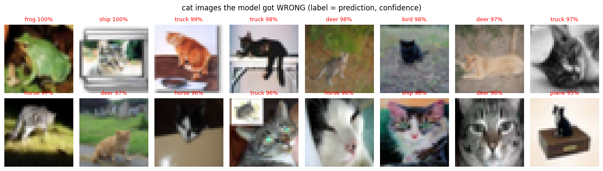
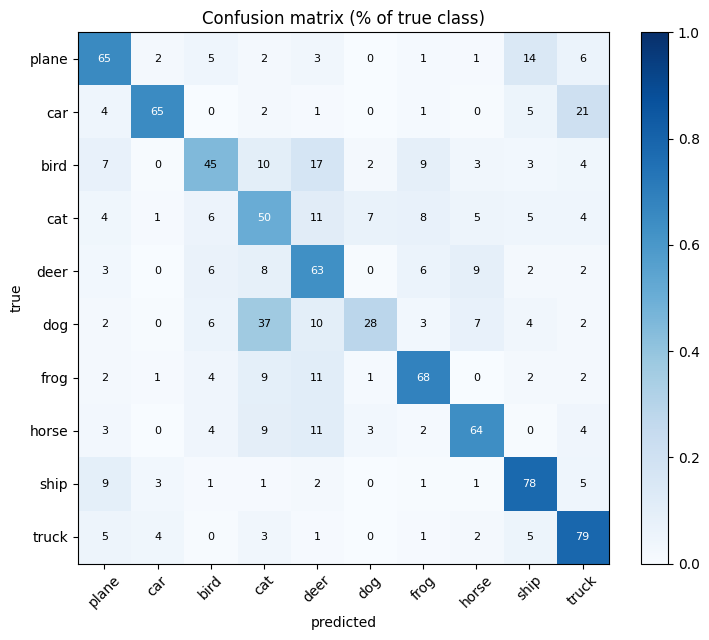
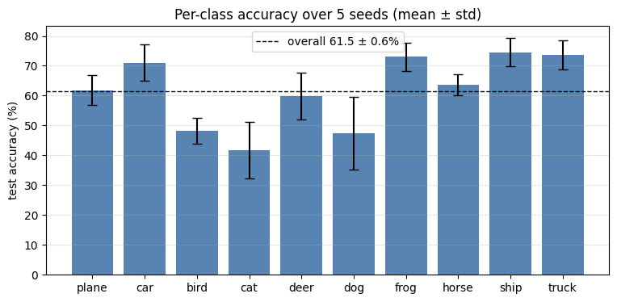

# CIFAR-10 · Beyond Accuracy

**작은 CNN은 무엇을 틀리고, 얼마나 확신하며 틀릴까?**

**PyTorch · Error Analysis · Confidence · Reproducibility**

[분석 노트북](cifar10_error_analysis.ipynb) · [상세 결과](results/summary.md) · [실행 방법](#실행-방법)

작은 PyTorch CNN을 학습하고 **어떤 오류를 내는지, 틀린 예측에도 얼마나 확신하는지, 시드에 따라 결과가 얼마나 달라지는지** 분석한 프로젝트입니다.



*정답은 모두 cat입니다. 이미지 위에는 모델의 예측 클래스와 최대 softmax 점수가 표시됩니다. seed 0의 고양이 오답 중 점수가 높은 16개를 골랐으며, 전체 테스트셋의 대표 표본은 아닙니다. 표시된 100%는 반올림된 점수입니다.*

## 핵심 결과

| 항목 | 저장된 실행 결과 |
|---|---:|
| 5개 시드 테스트 정확도, 평균 ± 표본 표준편차 | 61.5 ± 0.6% |
| 시드별 정확도 범위 | 60.6–62.1% |
| dog 정확도, 평균 ± 표본 표준편차 | 47.5 ± 12.1% |
| cat 정확도, 평균 ± 표본 표준편차 | 41.7 ± 9.5% |
| seed 0: dog → cat 오분류율 | 37.0% |
| seed 0: 신뢰도 ≥ 0.9인 예측의 오답률 | 9.4% (대상 2,916개) |

전체 정확도와 함께 클래스별 변동, 혼동 방향, 신뢰도와 실제 정답률을 확인했습니다. 높은 softmax 점수에서도 오답이 남았습니다.

## 결과를 그림으로 보기

### 01 · 어떤 클래스를 혼동하는가?



행은 정답, 열은 예측이며 각 행의 합은 약 100%입니다. seed 0에서 **dog의 37%가 cat으로 분류**되었습니다. 혼동 행렬은 오류의 방향을 보여주지만, 배경이나 색상이 원인인지는 별도 실험이 필요합니다.

### 02 · 같은 설정에서도 결과는 얼마나 달라지는가?



10 epoch, 동일한 설정에서 시드 0~4를 비교했습니다. 전체 정확도는 **61.5 ± 0.6%**지만 dog와 cat의 표준편차는 각각 **12.1%p, 9.5%p**입니다. 오차 막대는 표본 표준편차이며 신뢰구간이 아닙니다.

<details>
<summary>신뢰도·t-SNE 등 전체 그래프 보기</summary>

[노트북](cifar10_error_analysis.ipynb)에서 정답 이미지, 신뢰도 분포와 reliability diagram, 임계값별 accuracy·coverage, t-SNE를 포함한 전체 7개 그림을 볼 수 있습니다. README의 3개 그림은 제공된 `cifar10_error_analysis (4).ipynb`의 저장된 PNG 출력에서 그대로 추출했습니다. 학습을 다시 실행하지 않았습니다.

</details>

## 구현 내용

- PyTorch 모델·학습·평가 루프: 합성곱 2개, 완전연결층 3개
- 행 기준 정규화 혼동 행렬과 주요 오분류 쌍
- 고양이 정답·고신뢰도 오답 이미지 비교
- 신뢰도 분포, 10-bin ECE, 신뢰도 임계값별 정확도·coverage
- 84차원 특징 2,000개의 t-SNE 시각화
- 시드 0~4의 전체·클래스별 정확도 및 표준편차

그래프와 출력은 [분석 노트북](cifar10_error_analysis.ipynb), 상세 숫자는 [결과 요약](results/summary.md)에 있습니다.

## 실행 방법

[Colab에서 열기](https://colab.research.google.com/github/DoubleDeep-ai/cifar10-error-analysis/blob/main/cifar10_error_analysis.ipynb)

저장소가 비공개이면 노트북을 내려받아 Colab의 '노트북 업로드'로 열 수 있습니다.

1. Colab GPU 런타임을 선택하거나 로컬 Python 환경을 준비합니다.
2. Colab에 노트북만 업로드했다면 새 코드 셀에서 아래 명령으로 패키지를 설치합니다. 저장소 전체를 내려받은 로컬 환경에서는 저장소 폴더에서 `pip install -r requirements.txt`를 실행합니다.
3. 첫 설정 셀에서 Drive 사용 여부와 데이터 경로를 지정합니다. 로컬에서는 `USE_DRIVE=False`로 변경합니다.
4. 셀을 위에서부터 실행합니다. CIFAR-10 다운로드와 5회 학습이 수행됩니다.

```python
%pip install torch torchvision numpy pandas matplotlib scikit-learn
```

위 명령은 Colab/Jupyter 셀용입니다. 원본 패키지 버전이 고정되어 있지 않아 환경에 따라 실행 결과가 달라질 수 있습니다.

## 실험 설정

CIFAR-10 train 50,000 / test 10,000, 입력 32×32, 채널별 평균·표준편차 0.5로 정규화. 10 epoch, batch 32, SGD(lr=0.01, momentum=0.9), cross entropy. 데이터 증강은 적용하지 않았습니다.

## 해석 범위

제공된 노트북의 저장된 출력을 정리했으며 이번 게시 과정에서 재학습하지 않았습니다. 정확한 패키지 버전과 체크포인트는 포함되어 있지 않습니다. requirements.txt는 의존성 목록이며 검증된 버전 고정 환경이 아닙니다.

평균 ± 표준편차는 신뢰구간이 아닙니다. 테스트셋 기반 사후 분석이며, 배경 의존과 클래스 혼동의 원인은 추가 검증이 필요한 가설입니다. t-SNE와 위치추정에 대한 논의는 각각 탐색적 시각화와 개념적 연결입니다. 위치추정 구현은 포함하지 않습니다.

다음 실험에서는 별도 검증셋으로 보정·임계값을 선택하고 데이터 증강과 모델 변경을 통제 비교할 예정입니다.

## 다른 프로젝트

| 프로젝트 | 주요 내용 |
|---|---|
| [YOLO · 균열 세그멘테이션](https://github.com/DoubleDeep-ai/YOLO) | 토목 이미지의 균열 탐지·마스크 분석 및 SAM 후처리 |
| [CIFAR-10 · 오류 분석](https://github.com/DoubleDeep-ai/cifar10-error-analysis) | PyTorch CNN의 오분류·신뢰도·시드별 변동 분석 |
| [OSM · 캠퍼스 지도 분석](https://github.com/DoubleDeep-ai/osm-campus-map-analysis) | 공공 지도와 보행 네트워크의 공간정보 탐색 |

각 저장소는 독립된 프로젝트입니다. 비공개 저장소 링크는 접근 권한이 있는 계정에서 열립니다.
