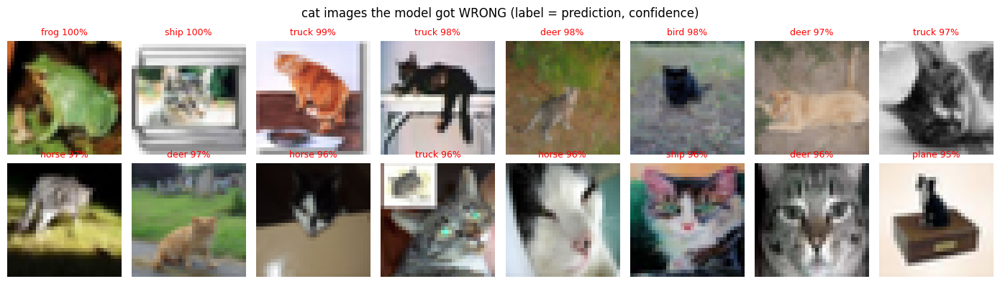
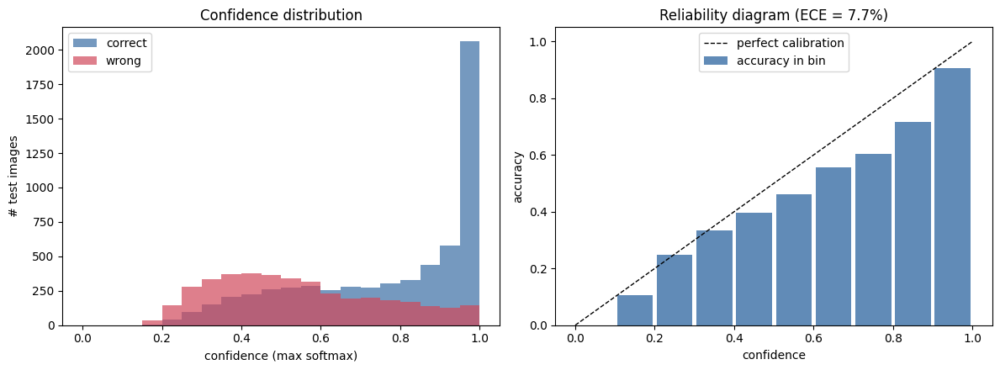

# CIFAR-10 작은 CNN 오류 분석

## 왜 했는지

작은 CNN은 무엇을 틀리고, 얼마나 확신하며 틀릴까?

전체 정확도만으로는 어떤 이미지를 틀리는지 알기 어려웠다. 자주 헷갈리는 클래스와, 높은 점수를 주고도 틀린 예측을 따로 살펴보고 싶었다.

## 설정

합성곱 2층·완전연결 3층의 CNN을 10 epoch, batch 32로 학습했다.  
SGD(lr 0.01, momentum 0.9)를 사용했고, 데이터 증강 없이 seed 0~4를 비교했다.

## 결과

| 항목 | 저장된 실행 결과 |
|---|---:|
| 5개 시드 테스트 정확도, 평균 ± 표본 표준편차 | 61.5 ± 0.6% |
| 시드별 정확도 범위 | 60.6–62.1% |
| dog 정확도, 평균 ± 표본 표준편차 | 47.5 ± 12.1% |
| cat 정확도, 평균 ± 표본 표준편차 | 41.7 ± 9.5% |
| seed 0: dog → cat 오분류율 | 37.0% |
| seed 0: 신뢰도 ≥ 0.9인 예측의 오답률 | 9.4% (대상 2,916개) |

전체 정확도는 시드 간 차이가 작았지만 dog·cat의 정확도는 크게 흔들렸다.  
seed 0에서는 dog의 37.0%를 cat으로 분류했고, 신뢰도 0.9 이상에서도 오답률이 9.4%였다.  
10-bin ECE는 약 7.7%로, 모델의 신뢰도와 실제 정답률에 차이가 있었다.

seed 0의 고양이 오답 중 신뢰도가 높은 16개를 골라 예측 클래스와 최대 softmax 점수를 표시했다.

정답·오답의 신뢰도 분포와 신뢰도 구간별 실제 정답률을 비교했다.

나머지 그림은 [노트북](cifar10_error_analysis.ipynb)에 정리했다.

## 한계

- 테스트셋 사후 분석이어서, 실제 사용할 임계값은 별도 검증셋에서 정해야 했다.
- 배경·색이 오류의 원인이라는 해석은 가설로 남겼다.
- 패키지 버전을 고정하지 못했다.

## 다음에 해 볼 것

별도 검증셋으로 보정·임계값을 선택하고, 데이터 증강과 모델 변경을 통제 비교하기로 했다.

## 실행

[Colab에서 열기](https://colab.research.google.com/github/DoubleDeep-ai/cifar10-error-analysis/blob/main/cifar10_error_analysis.ipynb)

GPU 런타임에서 셀을 위에서부터 순서대로 실행했다.

코드 작성에 AI 도구를 보조로 활용했으며, 실험 설계와 결과 해석은 직접 수행했습니다.
